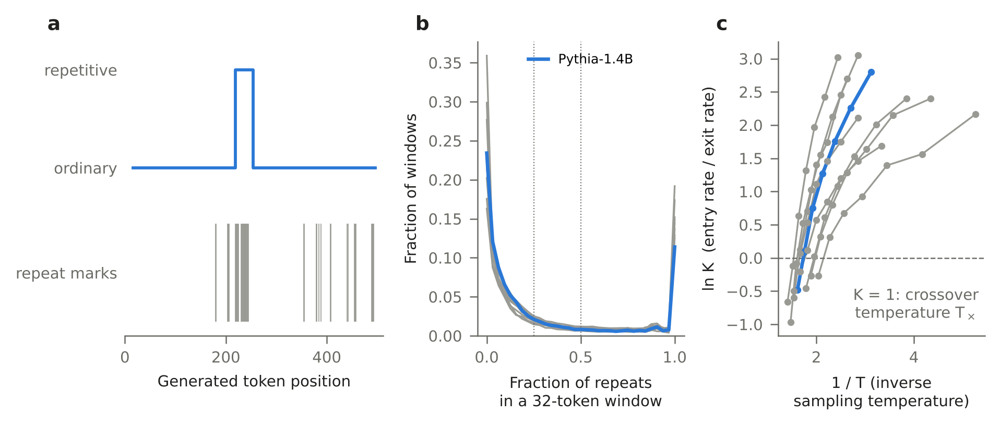
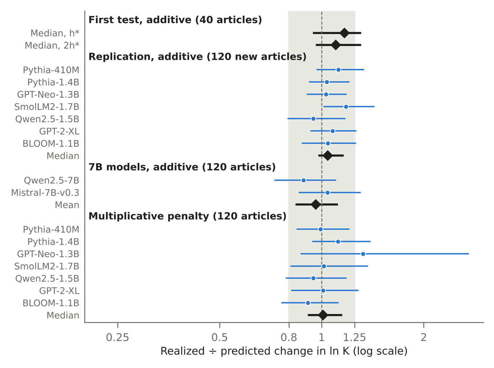
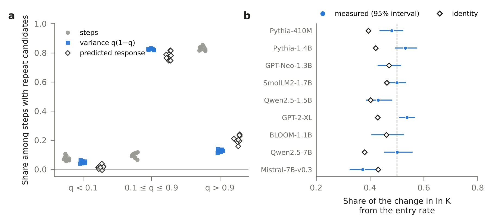
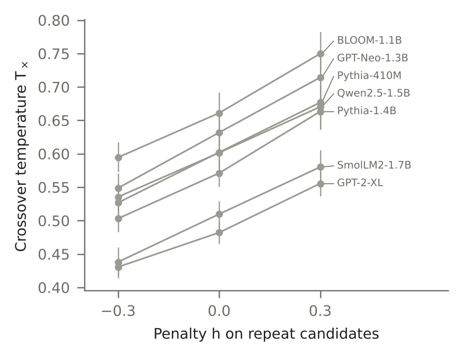
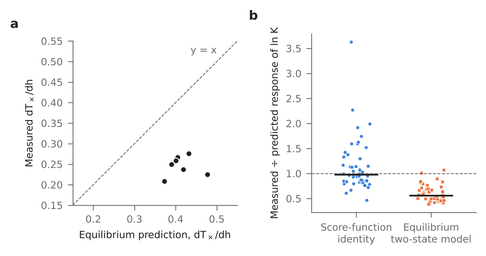

# Predicting how repetition penalties act in language models from unpenalized samples

## Abstract

A repetition penalty in a language model is applied, and the distribution renormalized, at every sampling step. We show that a first-order prediction of its effect on how text switches between repetitive and ordinary stretches, computed from samples generated without the penalty, holds at penalties large enough to shift that switching. We measure switching by the log ratio of the rates of entering and leaving labeled repetitive stretches. For an additive penalty h on repeat candidates, the tokens that have previously followed the current last two tokens, the derivative of a text's log-probability with respect to h, at h = 0, is (N − Q)/T. Here N counts the candidates chosen, Q sums over steps the probability of choosing one, and T is the temperature. Each term of Q is fixed by the text before its step, yet Q covaries with the switching statistics almost as strongly as N does. Step-wise normalization therefore cancels about 99% of the first-order response the same penalty would produce on whole texts. What it removes is the credit each choice would receive for the repeats it makes likely later. After an undecided first test, we replicated on new prompts in seven open base models, with the analysis registered in advance. With the derivative estimated from the unpenalized runs of the same test, the realized change divided by the prediction had a median of 1.04, with its bootstrap interval over prompts inside the registered range of 0.8 to 1.25. A separate test on two larger models also fell inside the range. The widely used multiplicative penalty followed the prediction only at strengths below those common in practice. The temperature at which the entry and exit rates are equal did not always move as intended. By this prediction, the response arises mainly at the minority of steps where the model is uncertain whether to repeat.

## I. Introduction

Language models that sample one token at a time sometimes fall into loops, repeating a phrase or a sentence until the end of the output. The problem is old and persists in current systems [1904.09751; 2012.14660; 2206.02369; 2310.10226; 2512.12895]. Repetition reinforces itself: the more often a phrase has been repeated, the more likely it is to be repeated again [2206.02369]. Adaptive sampling schemes have been designed partly to avoid it [2007.14966]. Training objectives that discourage repetition have been proposed [1908.04319]. At inference, the usual remedy is to penalize tokens that would repeat earlier text [1909.05858], although in a production setting such a penalty removed only some kinds of repetition [2512.04419]. Penalties derived from a model of expected frequencies have also been proposed [2607.22694].

Sampling at temperature T draws each token with probability proportional to exp(z/T), where z are the logits. Several studies have therefore described generated text in the language of statistical physics, with phases and transitions as the temperature changes [2406.05335; 2503.06330; 2405.17088; 2606.06238]. In small models, repetitive structure has been reported to appear only in a low-temperature ordered phase [2406.05335; 2503.06330]. These works describe generated text; they do not predict how an intervention such as a penalty acts. A natural shortcut would treat the penalty as an energy per repeat in a two-state Boltzmann system. Appendix H shows why this shortcut is not a reliable guide.

The Boltzmann form holds for each step and not for the text as a whole. At T = 1 the probability of a text is exp(−U(x)), with U the sum over its tokens of −log p at T = 1. At any other temperature, or with any change to the logits, the distribution is normalized afresh at every step [2503.21929]. The probability of a text is then, in general, not exp(−U(x)/T)/Z(T) for an additive energy U that is independent of T. The response of such a process to a change in its transition probabilities is given exactly by a likelihood-ratio, or score-function, formula [Glynn 1990; Williams 1992; Warren & Allen 2012]. We use this formula to predict the effect of a penalty from unpenalized samples, and we tested the predictions after registering them. The same formula shows why the effect is small, by measuring how much of a whole-text, Boltzmann-like response survives step-wise normalization, and locates where in a text a penalty acts.

The ingredients are known. Likelihood-ratio derivatives are standard in simulation and reinforcement learning. Locally normalized sequence models can be biased in ways that globally normalized ones are not, a problem known as label bias [Lafferty et al. 2001; Andor et al. 2016; Wiseman & Rush 2016]. Tilted ensembles of trajectories and their representation as Doob transforms are standard in statistical physics [Garrahan et al. 2009; Jack & Sollich 2010; Chetrite & Touchette 2015]. Language-model decoding has been steered by estimates of a future reward or attribute [Yang & Klein 2021; Zhao et al. 2024]. Kempton and Burrell described how local normalization distorts temperature and truncation relative to a global Boltzmann form [2503.21929]. What we add is a first-order prediction of a repetition penalty's effect, tested after registration. We also measure the distortion that explains why the effect is small, and locate where in a text the response arises.

## II. Setup

We sampled continuations of news articles published after the models were released, from nine open base models between 0.4 and 7.6 billion parameters (Table I; Appendix A). Sampling was plain softmax at temperatures between 0.19 and 0.90; each test used seven temperatures per model, centered on that model's design temperature (Appendix A), with no truncation such as top-k or top-p. End-of-sequence and padding tokens were excluded, and all probabilities below, including q_t, refer to this masked distribution. Each prompt was the first 64 tokens of an article, continued for 512 tokens. We call one round of computing the next-token logits, adjusting them, normalizing them and sampling one token a step.

**Repeats and penalties.** A sampled token is a repeat if the four tokens ending with it occurred earlier in the same continuation, that is, if it ends a repeated 4-gram. The penalty acts on a slightly broader set. At step t the repeat candidates are the tokens that have previously followed the current last two tokens, in the prompt or the continuation. We write c_t = 1 if the sampled token is a candidate and q_t for the total probability that the model, at temperature T and without the penalty, assigns to the candidates. Repeats define the states below; candidates define the penalty. Keeping them separate makes the definition of the states independent of the penalty. The additive penalty adds h to the logits of the candidates before division by T, so that h < 0 discourages repetition. This additive penalty is not an option of common libraries; it acts like a logit bias on a set that depends on the context, and we use it because its exact score has the simplest form. A widely used multiplicative penalty, implemented as repetition_penalty in common libraries, acts on a third set, every token seen before: before division by T, it divides their positive logits by θ and multiplies their negative logits by θ [1909.05858; 1910.03771].

**Two states and the crossover temperature.** Repeats cluster into long stretches separated by ordinary text. We label each step as repetitive or ordinary from the fraction of repeats in a 32-token window around the step, 16 tokens before it and 15 after. The label has hysteresis: a step enters the repetitive state when the fraction reaches 1/2 and leaves it when the fraction falls below 1/4 (Appendix A). The labels therefore use up to 15 later tokens. At each temperature we count switches into the repetitive state per ordinary step, the entry rate, and switches out of it per repetitive step, the exit rate. The ratio K = entry rate/exit rate measures the balance between the two states. We call the temperature at which K = 1 the crossover temperature T_×. Near T_×, ln K is close to linear in 1/T, as in a van 't Hoff plot; over wider ranges it curves. An analysis uses a temperature only if both kinds of switch occurred there at least ten times; we call these the usable temperatures.

The two states are a labeling, not distinct phases. The windowed repeat fraction has peaks near zero and one, but it did not meet a bimodality criterion we had fixed in advance (Appendix F1). K is also not the rate ratio of a stationary two-state Markov chain. The balance drifts towards repetition along a text, and repetitive stretches become harder to leave the longer they last (Appendix F2). We use K as a summary of switching statistics, averaged over positions and over stretches of different duration. T_× depends on the labeling and on the length of the continuation, so we compare it only within a fixed labeling and length.

## III. Theory

**A. Score of a penalized text.** A continuation x = (x_1, …, x_L) has probability P_h(x) = Π_t p_t^h(x_t | x_<t). For the additive penalty, the derivative of log p_t^h(x_t) at h = 0 is (c_t − q_t)/T. Summing over steps,

∂ log P_h(x)/∂h |_{h=0} = (N − Q)/T,  with N = Σ_t c_t and Q = Σ_t q_t.

Here the length L is fixed, with no early stopping; the identity also holds with a bounded stopping time, such as an end-of-sequence token kept in the normalization, but we did not use one. N is the number of candidates chosen. Q is its compensator, the sum of the probabilities of choosing a candidate given the text so far: each q_t is fixed by the text before step t, and N − Q has mean zero. For any statistic O of the text that does not itself depend on h, the response at h = 0 is therefore

∂E[O]/∂h = Cov(O, N)/T − Cov(O, Q)/T.

Applied to the four counts that define K, this gives the exact derivative g(T) = ∂ ln K/∂h, where K is defined by ratios of expected counts (Appendix B). For the multiplicative penalty, with λ = ln θ, c_t − q_t is replaced by a_t − E_t[a] (Appendix B). Here a is the derivative of a token's logit with respect to λ, and E_t the expectation under the step-t distribution.

**B. Step-wise penalty versus exponential tilting.** A penalty that acted on the text as a whole would instead reweight it. Reweighting each whole text by exp(hN/T) and renormalizing is exponential tilting in the language of statistics, and a tilted ensemble of trajectories in statistical physics. It gives the response Cov(O, N)/T, the static susceptibility of the path ensemble. The step-wise response equals this tilted response minus Cov(O, Q)/T. The difference has a direct meaning. Write N − E[N] as the sum of updates of the expected final count, E[N | x_≤t] − E[N | x_<t]. Each update is c_t − q_t plus ν_t, the change at step t in the expected number of chosen candidates after step t, a martingale increment. Summing over t gives N − E[N] = (N − Q) + Σ_t ν_t, so Q − E[Q] = Σ_t ν_t and

Cov(O, Q) = Cov(O, Σ_t ν_t).

Exponential tilting rewards each choice also for the future repeats it makes likely. Written step by step, the tilted ensemble is again an autoregressive process. Its step probabilities are multiplied by exp(hc_t/T) and by the expected future factor E[exp(hN_{>t}/T) | x_≤t], with N_{>t} the candidates chosen after step t, and renormalized. This is a finite-horizon Doob transform [Jack & Sollich 2010; Chetrite & Touchette 2015]. To first order in h, after both factors are renormalized, the second adds (h/T) Σ_t ν_t to the log-weight of a text. A step-wise penalty lacks it. Entering a repetitive stretch makes many future repeats likely, so this is where we expect the two to differ most. In machine-learning terms, this is the difference between locally and globally normalized sequence models [Andor et al. 2016]. Writing g_N for the response of ln K under exponential tilting by exp(hN/T), we call s_pen = g/g_N the fraction of the tilted response that survives step-wise normalization.

**C. Temperature.** Changing the temperature is also a step-wise change. With β = 1/T and energy U_t = −log p_t at T = 1,

∂ log P_β(x)/∂β = −(U − U_comp),  with U = Σ_t U_t(x_t) and U_comp = Σ_t E_t[U_t],

where E_t is the expectation under the step-t distribution at the current temperature. The step-wise response to temperature, which is what the van 't Hoff slope measures, therefore also subtracts a compensator. Exponential tilting by exp(−εU) does not. Because each step's expectation is subtracted, adding to U_t any constant that depends only on the history, for example replacing U_t by −z_t, leaves this score unchanged. The penalty score (N − Q)/T of Sec. III A contains no energy and does not depend on this choice. The corresponding fraction for temperature compares the van 't Hoff slope b with the response b_tilt of ln K to exponential tilting by exp(−εU) at ε = 0. Summed over temperatures, we define s_temp = Σ_u g_C(T_u)/Σ_u g_C^tilt(T_u), with the two equilibrium predictions of Appendix H; at a single temperature this equals b/b_tilt.

**D. An equilibrium shortcut.** A two-state Boltzmann model, with the penalty as an energy per chosen candidate, predicts the response from unpenalized samples as g_C(T) = (b/ΔE) Δc_T/T (Appendix H). Here ΔE is the difference in mean energy per step between the states, and Δc_T the difference in the rate of choosing a candidate. The prediction needs an energy for each step and changes with that choice; the exact identities and s_pen do not.

## IV. Results

### A. Two states and the crossover temperature

Consider a temperature where both kinds of stretch are common. There, the fraction of repeats in a 32-token window has a high peak near zero, a narrow peak at exactly one and a shallow trough in between (Fig. 1b). Between 74% and 89% of outputs, depending on the model, switch between the two kinds at least once (Appendix F1). Over the usable temperatures of the unpenalized runs, the models chose a repeat candidate at 92–94% of steps in the repetitive state and at 16–21% in the ordinary state (Appendix F1).

The crossover temperature lies between 0.44 and 0.66 for the nine models (Fig. 1c; Table I).

**Fig. 1 | Generated text alternates between repetitive and ordinary stretches.** **a**, Repeat marks (grey ticks) and labeled state (line; up, repetitive) along one unpenalized continuation of Pythia-1.4B at T = 0.62, chosen as the first output with two to six switches. **b**, Distribution of the fraction of repeats in a 32-token window at the test temperature closest to each model's crossover temperature, for unpenalized continuations of the 120 replication articles. Grey, eight models; blue, Pythia-1.4B. Dotted lines, the thresholds for leaving (1/4) and entering (1/2) the repetitive state. **c**, ln K, the log ratio of entry rate to exit rate, against inverse temperature for the same runs. The crossover temperature is where ln K = 0.

### B. Predicting a penalty before applying it

Penalizing or favoring the repeat candidates moved T_× in the direction of h, roughly linearly between h = −0.3 and +0.3 (Fig. S1). Because the derivative of Sec. III A needs only unpenalized samples, it predicts, from unpenalized runs on 40 design articles, the penalty h* that should lower T_× by 0.10, to the design temperature T* = T_× − 0.10. Before generating any penalized text for these tests, we fixed the procedure, the analysis code and the decision criterion in dated documents. The runs at h = ±0.3 behind Fig. S1 had been made earlier, on the design articles. The test compares the realized change in ln K at h* with the first-order prediction h* g(T), summed over the usable temperatures. Only h* was fixed beforehand; g was estimated from the unpenalized runs of the same test. The test therefore asks whether the first-order prediction still holds at a penalty large enough to matter. The criterion was that the bootstrap interval of the median ratio over models lie between 0.8 and 1.25.

The first test, on the 40 articles from which h* had been computed, did not decide: the median ratio was 1.17 at h* and 1.10 at 2h*, and both intervals reached just above 1.25. Per-model values are in Appendix F3. We then committed in advance to a single replication on 120 new articles, with the same rule and statistic. The median ratio was 1.04 (95% interval 0.98–1.15), inside the range (Fig. 2; Table I). The range would have rejected the tilted response, which gives a ratio of about 0.01. It would also have rejected the equilibrium two-state model for six of the nine models, by its ratio ρ_eq computed after the tests (Appendix H). The decision concerned the median; the intervals of individual models were wider, and for five of the nine models they reached above 1.25. Under eight other labelings of the states, the median ratio stayed between 0.96 and 1.08 (Table F2). The agreement is not an artifact of summing over temperatures: across the usable temperatures of each model, the ratio did not drift systematically, changing by a median of 0.01 (−0.446 to 0.161) over the smaller models, although single temperatures were imprecise (Appendix F10). A separate test repeated the whole procedure for two 7-billion-parameter models, with a mean ratio of 0.96 (0.84–1.11). In an exploratory analysis after the tests, we replaced the denominator by the design prediction alone, h* ḡ at every temperature, with ḡ the temperature-averaged g from the design articles. The median ratio was then 1.05 (0.99–1.11) for the smaller models and the mean 1.07 for the larger ones (Appendix F4). These intervals do not include the sampling error of ḡ.

The same procedure predicted the divisor θ of the multiplicative penalty: 1.02–1.05 for six models and 1.51 for GPT-Neo-1.3B. At these strengths the median ratio over seven models was 1.01, inside the range. A further test multiplied the predicted strength λ* = ln θ* by two, four and eight for the six models. The median ratio was 1.00, then 0.86, which did not decide, and 0.52, below the range. The first-order prediction thus holds up to θ of about 1.1, the lower end of the values used in practice, and stronger divisors act less than it predicts. GPT-Neo-1.3B at twice its strength went the other way, and for two instruction-tuned models the test did not decide or could not be run (Appendix F5).

For a user, what matters is where T_× ends up. With T_× from a straight-line fit of ln K against 1/T, as in the design, it moved further than intended: by a median of 1.3 times the intended shift in the smaller models and about twice in the larger ones. Because ln K curves (Fig. 1c), we also located each crossing by interpolation, in an analysis after the tests. The median for the smaller models then became 0.87 (0.80–1.03; Appendix F6), so curvature accounts for most of the median overshoot. Individual models, GPT-2-XL most of all, and the mean of the larger models still departed from the target, for reasons we have not identified. For GPT-2-XL the design runs had already shown a response larger than the identity predicted (Table F10).

**Fig. 2 | Prospective tests.** Ratio of the realized change in ln K to the first-order prediction, with 95% bootstrap intervals over articles, for each preregistered test. Circles, individual models. Diamonds, the test statistic (median or mean) with its interval. The multiplicative block is at the predicted divisor θ*; the stronger divisors and the instruction-tuned models are in Appendix F5. For the first test only the statistics are shown, for h* and 2h* (per-model values in Appendix F3). Grey band, the preregistered range 0.8–1.25. Logarithmic axis.

**Table I | Models and prospective tests.** Crossover temperature T_×: unpenalized, from the fit used for the prediction. h*: predicted additive penalty on the logits of repeat candidates (before division by temperature) that should lower T_× by 0.10. Ratio: realized change in ln K divided by the identity's first-order prediction, summed over the test temperatures, with a 95% bootstrap interval over articles (120 articles in each test). First seven models: preregistered replication. Last two models: preregistered test on 7-billion-parameter models. Decision band for the ratio: 0.8–1.25 (median over the first seven models; mean over the last two).

| Model | Parameters (billions) | T_× | h* | Ratio | 95% interval |
|---|---|---|---|---|---|
| Pythia-410M | 0.41 | 0.60 | −0.40 | 1.12 | 0.97–1.33 |
| Pythia-1.4B | 1.4 | 0.57 | −0.50 | 1.03 | 0.92–1.20 |
| GPT-Neo-1.3B | 1.3 | 0.63 | −0.39 | 1.03 | 0.91–1.18 |
| SmolLM2-1.7B | 1.7 | 0.51 | −0.53 | 1.18 | 1.02–1.42 |
| Qwen2.5-1.5B | 1.5 | 0.60 | −0.47 | 0.94 | 0.80–1.17 |
| GPT-2-XL | 1.6 | 0.48 | −0.79 | 1.08 | 0.93–1.26 |
| BLOOM-1.1B | 1.1 | 0.66 | −0.37 | 1.04 | 0.88–1.26 |
| Median (first seven) | | | | 1.04 | 0.98–1.15 |
| Qwen2.5-7B | 7.6 | 0.55 | −0.67 | 0.88 | 0.73–1.10 |
| Mistral-7B-v0.3 | 7.2 | 0.44 | −0.35 | 1.04 | 0.86–1.30 |
| Mean (last two) | | | | 0.96 | 0.84–1.11 |

### C. Step-wise normalization cancels almost all of the tilted response

The responses predicted and confirmed above are small compared with what the same penalty would do if it reweighted whole texts. Table II compares each step-wise response with the response under exponential tilting, on the unpenalized runs of the replication and of the test on the larger models. For the penalty, the step-wise response of ln K was between 0.7% and 1.5% of the tilted response (s_pen; median 1.2% over the seven smaller models). For temperature it was between 0.8% and 2.3% (s_temp). The compensator thus cancels about 99% of the first term. These are ratios of derivatives at h = 0; we did not apply exponential tilting at a finite h. The tilted response credits each choice also with the future repeats it makes likely (Sec. III B), and nearly all of the covariance of the switching counts with N comes through those future repeats. Q carries the same expected future repeats, so the two terms cancel, and what survives is the response to the choices themselves.

These fractions use covariances within articles and texts of 512 tokens; other covariance conventions and the local form of s_temp give the same picture (Appendices B and F8). Shorter texts keep more, consistent with fewer future repeats following each choice: for the first 256 tokens s_pen was 1.8%. These fractions are exploratory records: they were defined in a dated document before they were computed, without a decision rule (Table C1).

**Table II | Fractions of the tilted responses that survive step-wise normalization.** s_pen: the step-wise response of ln K to the penalty as a percentage of its response to exponential tilting by exp(hN/T). s_temp: the van 't Hoff slope as a percentage of the response of ln K to exponential tilting by exp(−εU), with U = −log p at T = 1, summed as defined in Sec. III C. Sums over the usable temperatures, unpenalized runs on the 120 articles of the replication (smaller models) and of the test on the larger models. Unlike s_pen, s_temp depends on the energy assigned to a step. The factors relating these fractions to the equilibrium shortcut are in Appendix H.

| Model | s_pen (%) | s_temp (%) |
|---|---|---|
| Pythia-410M | 1.3 | 1.9 |
| Pythia-1.4B | 1.3 | 1.8 |
| GPT-Neo-1.3B | 1.5 | 2.1 |
| SmolLM2-1.7B | 1.1 | 1.4 |
| Qwen2.5-1.5B | 0.8 | 1.7 |
| GPT-2-XL | 1.1 | 1.1 |
| BLOOM-1.1B | 1.2 | 2.3 |
| Qwen2.5-7B | 0.7 | 1.4 |
| Mistral-7B-v0.3 | 0.7 | 0.8 |

### D. Where the penalty acts

The derivative also says where in a text the penalty acts. Each step contributes c_t − q_t to the score, a term with variance q_t(1 − q_t). Steps at which the model has almost decided to repeat, with q_t above 0.9, make up more than four-fifths of the steps with repeat candidates but carry only about a fifth of the predicted response. Steps with q_t between 0.1 and 0.9 make up about a tenth of those steps but carry about four-fifths of the response, close to their share of the variance (Fig. 3a). The form of the score does not by itself fix these shares, since a step's contribution is bounded by the square root of its variance, not proportional to it. For the steps with 0.1 ≤ q_t ≤ 0.9, the share of the response nevertheless follows the share of the variance closely. An exploratory analysis with a rule fixed before it was run (Table C1) took the ratio of the two shares for these steps, with an interval of its median inside 0.8–1.25 counting as proportional. The median was 0.96 (0.91–0.98). In the other two bands the shares differ from the variance shares (Fig. 3a). This is a decomposition of the first-order response, not a test of a penalty applied only to these steps.

This does not mean that the penalty only prevents loops from forming. About half of the change in ln K came from a lower entry rate and half from a higher exit rate, in the smaller and the larger models alike (Fig. 3b). The entry rate's share had a median of 0.48 (0.46–0.51) over the smaller models and a mean of 0.44 (0.40–0.47) over the larger ones. A rule fixed before this exploratory analysis read an interval inside 0.33–0.67 as both rates contributing. The identity predicts the total change well, and its split between the two rates only roughly. Taking the difference between the identity's entry share and the measured one within the same resamples, the identity put slightly more of the response on the exit rate: the median difference over the smaller models was −0.04 (−0.11 to −0.002), and the difference excluded zero for two of the nine models (exploratory, rule fixed; Appendix F10). A penalty nevertheless both makes repetition harder to start and makes loops break more readily.

**Fig. 3 | Where the penalty acts.** **a**, For steps with repeat candidates, split by the model's probability q_t of choosing one (below 0.1, 0.1–0.9, above 0.9): share of the steps, share of the variance Σ q_t(1 − q_t) and share of the identity's predicted response, for the nine models at the test temperatures. **b**, Share of the realized change in ln K that comes from the change in entry rate (blue, 95% interval) and the share predicted by the identity (open diamonds). The rest comes from the exit rate. The interval shown is that of the measured share alone; the difference between the two shares, with both uncertainties, is in Appendix F10.

## V. Discussion

The effect of a repetition penalty on the switching statistics of repetition can be computed from samples generated without it. In tests registered in advance, this first-order prediction matched the realized change at penalties large enough to move T_×. In an exploratory analysis, a prediction from the design articles alone carried over to new articles with a median ratio of 1.05 (Appendix F4). The effect is small because step-wise normalization changes what a penalty is. Acting on whole texts, a penalty would also reward each choice for the repeats it makes likely later. Acting step by step, it reaches only the choice itself, and about 99% of the whole-text first-order response is removed. The prediction depends on how far each choice departed from the model's own probability of repeating, not on the number of repeats alone. The compensator Q is the discrete-time counterpart of the escape-rate term in response theory for jump processes [0902.3955; 2005.10503], although that theory separates terms by time reversal, which autoregressive sampling lacks.

The first-order prediction held at penalties with |h*|/T* between 0.7 and 2.1. There, the exact probability ratios of the unpenalized samples concentrated on few samples: with four samples per prompt, the effective sample size was 1.3 to 2.1 (Appendix D). We read this as a difference of scale, which we have not tested. The probability ratio of a whole text is a product over 512 steps, so small changes at many steps compound. ln K is instead the log of a ratio of counts summed over many steps and texts. Each step changes it only slightly, so its response stays close to linear.

A natural shortcut, an equilibrium two-state model that treats the penalty as an energy, is not a reliable guide. With −log p as the energy of a step it overstated the effect by about 45%; with the logits it understated it, or predicted the wrong sign (Appendix H). Its verdict is a property of the chosen energy, which the sampler does not define.

The derivative applies in the same way to any small additive change to the logits, such as logit biases and watermarking biases [2301.10226]. It also carries over to truncated sampling such as min-p [2407.01082] or top-p [1904.09751] if q_t is taken within the truncated set (Appendix G). We tested only the two repetition penalties, without truncation. Locating T_× required unpenalized runs at several temperatures, comparable in cost to trying a few penalty strengths. The same runs, however, give the response to any such change and show where in the text it arises.

The study has clear limits. Because the registered tests estimated the derivative from their own unpenalized runs, they test whether the first-order prediction holds at h*. A prediction made before any test data existed was examined only in an exploratory analysis (Appendix F4). The confirmation rests on one replication after an undecided first test and on one test of two larger models, and the additive, multiplicative and larger-model tests share the same 120 articles. Decisions concerned the median over models, and the bootstrap intervals resample articles, not models. All prospective tests used English news articles and base models of up to 7.6 billion parameters; preregistered runs on novels, scientific papers and code are in Appendix F9. For instruction-tuned models the test did not decide, and the widely used presence and frequency penalties were not tested. The multiplicative prediction held only for divisors below those common in practice; at four times the predicted strength the test did not decide, and at eight times the ratio fell below the range (Appendix F5). The two states are a labeling of a continuum, K averages over a drift along the text, and s_pen depends on the length of the text. The shift of T_× itself, which a user would target, did not always match the intended 0.10. For the smaller models its median was 1.32 times the target with a straight-line fit and 0.87 with interpolation. GPT-2-XL and the larger models moved further, for reasons we have not identified (Sec. IV B). Model revisions were not pinned in the code, although the revisions used can be identified (Appendix A). The code and the derivations were written by an AI assistant under the author's direction. They were checked by tests, an independent reimplementation and other AI instances, not line by line by the author (Appendix E).

## Appendices

### Appendix A: Data, labeling and rates

#### Models, prompts and sampling

We used nine open base models: Pythia-410M and Pythia-1.4B (EleutherAI/pythia-410m, EleutherAI/pythia-1.4b), GPT-Neo-1.3B (EleutherAI/gpt-neo-1.3B), SmolLM2-1.7B (HuggingFaceTB/SmolLM2-1.7B), Qwen2.5-1.5B and Qwen2.5-7B (Qwen/Qwen2.5-1.5B, Qwen/Qwen2.5-7B), GPT-2-XL (openai-community/gpt2-xl), BLOOM-1.1B (bigscience/bloom-1b1) and Mistral-7B-v0.3 (mistralai/Mistral-7B-v0.3). The instruction-tuned models in Appendix F5 were Qwen/Qwen2.5-1.5B-Instruct and HuggingFaceTB/SmolLM2-1.7B-Instruct. Weights were loaded from the main branch of the Hugging Face Hub without pinning a revision in the code. The latest commits of all nine repositories predate our runs, so the runs used these revisions: pythia-410m 9879c9b, pythia-1.4b fedc38a, gpt-neo-1.3B dbe59a7, SmolLM2-1.7B effd688, Qwen2.5-1.5B 8faed76, Qwen2.5-7B d149729, gpt2-xl 15ea56d, bloom-1b1 eb3dd73 and Mistral-7B-v0.3 caa1feb.

Prompts came from recent BBC News articles in the RealTimeData/bbc_news_alltime collection [LatestEval, Li et al. 2024] (April to June 2025). We split each article into paragraphs, dropped paragraphs shorter than 60 characters and boilerplate lines such as image captions, and kept articles of at least 4,000 characters. The first set of 40 articles was drawn with a fixed seed after sorting the pool by a hash of the article link. A second set of 120 articles, in three groups of 40, was drawn later from the same pool after removing duplicates and the first 40. The two sets do not overlap.

The prompt was the first 64 tokens of the cleaned article in each model's own tokenizer, with a beginning-of-sequence token only where the tokenizer adds one by default. Each prompt was continued for 512 tokens, with four samples per prompt. Sampling drew each token from softmax(z/T), where z are the logits, with no top-k or top-p truncation. End-of-sequence tokens, the <|endoftext|> token and unused padding entries of the vocabulary were excluded, so that every continuation had the same length. Articles shorter than 576 tokens in a model's tokenizer were not used. All computation used 32-bit floating point with TF32 disabled, and sampling probabilities were computed in 64-bit floating point.

Random seeds depended on the temperature, the sample and the batch, but not on the penalty. Penalized and unpenalized runs therefore shared their random numbers, which reduces the variance of their difference. Some runs were inadvertently repeated on separate L4 GPUs, and the repeats gave bit-identical outputs.

#### Repeats, states and rates

We marked step t of a continuation as a repeat if the four tokens ending at t had occurred, in the same order, ending at an earlier step of the same continuation, overlapping occurrences included. The first three steps are never repeats. The prompt is not used for this mark. We then computed the fraction of repeats in a sliding window over steps k to k + 31 and assigned it to step k + 16. States were labeled for steps 16 to 496 with hysteresis. A step enters the repetitive state when the windowed fraction reaches 1/2 and returns to the ordinary state when it falls below 1/4. The first labeled step is repetitive if its window fraction is at least 1/2 and ordinary otherwise.

At each temperature we summed four counts over samples and articles. M₀ and M₁ are the numbers of pairs of consecutive labeled steps whose first step is ordinary or repetitive, 480 pairs per continuation. n₀₁ is the number of switches from ordinary to repetitive, and n₁₀ the number of switches back. The entry rate is n₀₁/M₀ and the exit rate n₁₀/M₁, and

ln K = ln(n₀₁/M₀) − ln(n₁₀/M₁).

All four counts are taken over pairs of consecutive labeled steps, classified by the state of the first step of the pair. A temperature was used only if it had at least ten entries and ten exits, and a fit needed at least three usable temperatures.

We fitted ln K = a + b/T by weighted least squares over the usable temperatures, with weights 1/(1/n₀₁ + 1/n₁₀), the inverse of the approximate variance of ln K. The crossover temperature is T_× = −b/a, defined when b > 0 and a < 0. Fits used seven temperatures spaced by 0.05. For the design of the seven smaller models these were 0.40 to 0.70; the prospective tests used grids centered on each model's design temperature (Appendix C). For the two larger models we first fitted 15 temperatures from 0.20 to 0.90, then refitted on the seven consecutive temperatures centered near that estimate.

### Appendix B: Penalties, identities and tilted responses

#### Repeat candidates and penalties

The penalty acts on repeat candidates. At each step these are the tokens that have previously followed the current last two tokens, anywhere in the prompt or the continuation. The additive penalty adds h to their logits before division by the temperature, so that negative h discourages repetition. q_t is the probability of the candidate set under softmax(z/T), and c_t indicates whether the sampled token was a candidate. The marks used for labeling and the candidates used for the penalty are related but not identical. This keeps the definition of the states independent of the penalty.

The multiplicative penalty follows the implementation in the Hugging Face transformers library [1910.03771], which adapts the penalty of CTRL [1909.05858]. Before temperature scaling, the logit of every token that has appeared earlier, including in the prompt, is divided by θ if it is positive and multiplied by θ otherwise.

#### Score-function identity

For token-by-token sampling the log-probability of a continuation x is Σ_t log p_t(x_t), where p_t depends on the penalty. For the additive penalty, ∂ log p_t(x_t)/∂h = (c_t − q_t)/T. Hence, for any statistic Y of the continuation, with the sum running over all 512 generated steps,

∂E[Y]/∂h at h = 0 equals Cov(Y, σ)/T, with σ = Σ_t (c_t − q_t),

where the covariance is taken over unpenalized samples. We applied this to each of the four counts M₀, n₀₁, M₁ and n₁₀ of a continuation. With d_i = Cov(e_i, σ)/(T E[e_i]) for count e_i, the predicted response is

g(T) = ∂ln K/∂h = (d₀₁ − d₀) − (d₁₀ − d₁).

Covariances were population covariances pooled over all samples and articles at a temperature, with article weights for the bootstrap. For the multiplicative penalty, with λ = ln θ, the derivative of a logit at λ = 0 is −|z| for tokens already seen and zero otherwise. The same identity then holds with σ replaced by Σ_t A_t, where A_t = a(x_t) − Σ_v p_t(v) a(v) and a(v) = −|z_v| for seen tokens. The identity is exact; the prediction of a finite penalty from it is first order.

#### Exponential tilting

For a continuation let N = Σ_t c_t, Q = Σ_t q_t and U = Σ_t U_t, with U_t the energy of step t at T = 1. Reweighting each unpenalized continuation as a whole by exp(hN/T) would change ln K at rate g_N, computed as g(T) above with σ replaced by N. The step-wise penalty has σ = N − Q, so g = g_N − g_Q exactly when all three use the same covariance convention. Let g_U be the response of ln K to exponential tilting by exp(εU/T), computed as g with σ replaced by U. The response to tilting by exp(−εU) at ε = 0, the tilted analogue of the van 't Hoff slope b, is then b_tilt = −T g_U. For these comparisons, covariances were computed within articles: for each article, the covariance over its S = 4 samples with divisor S − 1, averaged with equal weight over articles. In d_i, E[e_i] remains the mean over all samples and articles at that temperature.

#### Temperature identity and the choice of energy

To check the identity of Sec. III C we rescored the unpenalized texts of the replication with the same models. At every step we recomputed the logits at the sampling position, U_t(x_t) and its expectation E_t[U_t] at the sampling temperature, and the log-normalizer. The rescored U and q agreed with the values recorded during generation to within 0.0015 and 0.0007 at most. With s = −Σ_t (U_t(x_t) − E_t[U_t]), the predicted ∂ln K/∂β was formed from the four counts as g was, and integrated over β by the trapezoidal rule over the usable temperatures. The measured change of ln K between the lowest and the highest usable temperature, divided by this integral, had a median of 0.98 (0.92–1.12) over the seven smaller models. This lay inside the range 0.8–1.25 set by a rule fixed before this exploratory analysis. For six models it lay between 0.94 and 1.12; for BLOOM-1.1B it was 0.82 (0.72–0.96). We have not determined whether the trapezoidal rule or the small counts at the ends cause the BLOOM value. Defining s_temp from this local identity instead of the straight-line slope b changed its median over the seven smaller models from 1.82% to 1.85%.

### Appendix C: Prospective tests

#### Response to a fixed penalty

For the seven smaller models we generated continuations of the first 40 articles at seven temperatures from 0.40 to 0.70, with h = −0.3, 0 and +0.3. From these runs we fitted T_× at each h and took the slope of T_× against h as the measured shift. At each temperature the measured response of ln K was (ln K(+0.3) − ln K(−0.3))/0.6. The unpenalized arm of these runs also served to predict h* and θ*.

#### Prospective tests

Each test followed the same procedure, fixed in a dated document before any penalized text was generated. From unpenalized runs we estimated a, b and T_×, and the mean ḡ of g(T) over the fitting temperatures (over the temperatures with a defined g, at least five, for the larger models). The predicted penalty was h* = −(a + b/T*)/ḡ with T* = T_× − 0.10, rounded to four decimals for generation. We then generated unpenalized and penalized continuations at seven temperatures, T* rounded to 0.01 plus or minus up to 0.15 in steps of 0.05, on the same articles and with shared random numbers.

For each model, Δ(T) = ln K(T, h*) − ln K(T, 0) was compared with the prediction P(T) = h* g(T), where g was computed from the unpenalized arm of the same test. The ratio was ρ = Σ_u Δ(T_u)/Σ_u P(T_u) over the usable temperatures u. Usable temperatures needed at least ten entries and ten exits in both arms. They were fixed at the point estimate and kept in every bootstrap resample. A model was dropped if fewer than two temperatures were usable, and the median was computed only if at most two of the seven models were dropped. The test statistic was the median of ρ over the seven smaller models, or the mean over the two larger ones. Intervals were 2.5–97.5 percentile intervals from 1,000 bootstrap resamples of articles, using the same resample for all models and both arms.

The decision rule was set before each test. The prediction was confirmed if the 95% interval of the statistic lay within 0.8 to 1.25. It was called larger or smaller than predicted if the interval lay entirely above 1.25 or below 0.8, and reversed if it lay entirely below 0. It was undecided otherwise, or if the statistic could not be computed in more than 10% of resamples. For the larger models, T_× was first fitted on 15 temperatures from 0.20 to 0.90. The fit was then repeated on the seven consecutive temperatures centered on the grid point nearest that estimate, and re-centered once if the estimate moved. A model was not predicted if a fit failed or the 15-temperature estimate fell outside 0.3 to 0.8. It was also not predicted if the final T_× fell outside its seven temperatures, if fewer than five temperatures gave g, if ḡ was not positive, or if the test grid would reach below 0.10.

There were three tests of the additive penalty on base models. The first used the 40 articles from which h* had been computed, with arms at h* and 2h*, and both were undecided. A single replication on the 120 new articles was then committed to, with its decision rule, before any of its data existed. The third test applied the whole procedure, including the estimation of T_×, to the two 7-billion-parameter models on the same 120 articles. The test of instruction-tuned models (Appendix F5) followed the rules for the larger models. For the multiplicative penalty, ∂ln K/∂λ was computed by re-scoring the unpenalized runs that gave h*, without generating new text, and averaged over their seven temperatures to give ḡ_λ. With the same a, b and T*, the prediction was λ* = −(a + b/T*)/ḡ_λ and θ* = e^{λ*}, rounded to four decimals. A model was not predicted if ḡ_λ was not negative or θ* fell outside 1 to 3. The unpenalized arm of the replication served as the control, and the decision rule was unchanged.

Before each test we committed the procedure, the analysis code with its SHA-256 hashes and the decision rule to a version-controlled repository. Predictions were written to files whose hashes were recorded before penalized generation, and the notebooks that generated penalized text checked these hashes before running. One post-freeze change was made to analysis code, a missing import statement in the script for the whole-sequence analysis; it did not change any computation.

#### Design choices

The test statistic sums the realized and predicted changes over the usable temperatures before dividing. The change at a single temperature is noisy and can be close to zero, and the ratio of sums weights each temperature by the size of its change. The decision used the median over the seven smaller models so that no single model could decide it; for the two larger models we used the mean. The range 0.8–1.25 is symmetric on a logarithmic scale. It was set before the first test, from the agreement already seen on the design runs at h = ±0.3, with medians of 1.00 and 0.96, and from a synthetic check in which the labeling raised the ratio by about 10%.

The first test used 40 articles, and the interval of its median was 0.35 wide. We expected 120 articles to narrow it by about 1/√3, to about 0.2, which can fall inside a range 0.45 wide. This number was fixed before the replication, and no further replication was planned.

Every repeat is also a chosen candidate, because a token that ends a repeated 4-gram has followed its two preceding tokens before. Matching candidates on two preceding tokens rather than three lets the penalty act already at the step where a repetition would start, and keeps the events that define the states distinct from the events the penalty acts on.

End-of-sequence tokens were masked so that every continuation has the same length. The counts are then comparable across temperatures and penalties, and the score is a sum over a fixed number of steps. The length of 512 tokens was fixed in the first experiments of the project and kept for comparability; s_pen depends on it (Appendix F8).

**Table C1 | Status of each analysis.** Preregistered: procedure, code and decision rule committed in a dated document before the data were generated or opened. Exploratory: defined after the data of the prospective tests had been analyzed; "rule fixed" means that its definition and decision rule were committed before it was run, and "record" that it had no decision rule.

| Analysis | Where | Status | Outcome |
|---|---|---|---|
| Additive penalty, 40 design articles | IV B; F3 | Preregistered | Undecided (1.17 at h*, 1.10 at 2h*) |
| Additive penalty, replication on 120 new articles | IV B | Preregistered | Within the range (1.04) |
| Additive penalty, two 7-billion-parameter models | IV B | Preregistered | Within the range (0.96) |
| Multiplicative penalty at θ* | IV B; F5 | Preregistered | Within the range (1.01) |
| Multiplicative penalty at 2, 4 and 8 times λ* | IV B; F5 | Preregistered | Within; undecided; below |
| Instruction-tuned models | F5 | Preregistered | Undecided or not run |
| Shift of T_× on the design runs (Fig. S2a) | F7 | Preregistered | Smaller than the equilibrium prediction |
| Other genres | F9 | Preregistered | See F9 |
| Fractions s_pen and s_temp (Table II) | IV C | Exploratory, record | — |
| Response by q_t (Fig. 3a) | IV D | Exploratory, rule fixed | Proportional to the variance (0.96) |
| Entry share of the change in ln K (Fig. 3b) | IV D | Exploratory, rule fixed | Both rates (0.48; 0.44) |
| Bimodality and other labelings | II; F1 | Exploratory, rule fixed | Not bimodal; within the range under all labelings (seven smaller models) |
| Drift and persistence along the text | F2 | Exploratory, rule fixed (persistence) | Long stretches harder to leave |
| Prediction from the design articles alone | F4 | Exploratory, rule fixed | Within the range (1.05) |
| Shift of T_×, straight-line fit | IV B; F6 | Exploratory, rule fixed | Undecided (1.32); larger than intended (2.17) |
| Shift of T_×, interpolated | IV B; F6 | Exploratory, rule fixed | Within the range (0.87) |
| Shift of T_×, quadratic fit | F6 | Exploratory, record | 0.95 |
| s_pen against length and covariance convention | F8 | Exploratory, rule fixed | About 1% in all three judged cases |
| Temperature identity | B | Exploratory, rule fixed | Within the range (0.98) |
| Equilibrium ratio ρ_eq | H | Exploratory, record | 0.69 |
| ρ_eq in each half of the text | F7 | Exploratory, rule fixed | First half just failed the rule |
| Drift of the ratio across temperatures | IV B; F10 | Exploratory, rule fixed | No drift beyond the range width (smaller models) |
| Identity's entry share minus the measured one | IV D; F10 | Exploratory, rule fixed | Slightly more on the exit rate |
| Other rules for usable temperatures | F10 | Exploratory, rule fixed | Undecided: no rule changed any temperature |

### Appendix D: Importance reweighting

Reweighting unpenalized continuations by their exact probability ratio gives log-weights

log w = Σ_t [ (h/T) c_t − log(1 − q_t + q_t e^{h/T}) ].

We measured the effective sample size per article as (Σw)²/Σw² over its four samples, averaged over temperatures and articles. At h*, it was between 1.3 and 2.1 out of 4. With four samples per article this estimate is itself noisy, and we did not try self-normalized weights pooled over articles.

### Appendix E: Code, AI assistance and compute

#### Code and AI assistance

The author designed the questions, the tests and the decision rules. The analysis and data-collection code was written by an AI assistant (Claude, Anthropic) under the author's direction, and the author did not check it line by line. The derivations of Sec. III and Appendices G and H were likewise written by an AI assistant and checked by other AI instances, not by the author. Each analysis ran self-tests on synthetic data with known answers before touching real data, and a separate AI instance without access to the project history reviewed each design and its code before data collection. Later scripts had to reproduce earlier recorded results to within 10⁻⁹, and runs that had been inadvertently repeated on separate GPUs agreed bit for bit. A separate AI instance that had not seen the code reimplemented the estimator from its written description in these appendices alone. On the replication data it reproduced each model's ratio and the median to four decimal places.

#### Compute

Generation for the smaller models ran on NVIDIA L4 GPUs and for the 7-billion-parameter models on NVIDIA A100 (40 GB) GPUs, through a cloud notebook service. The recorded generation time of the replication summed to about 22 L4 GPU-hours for the seven smaller models, and that of the second stage of the test on the larger models to about 6 A100 GPU-hours. The prediction itself needs only the unpenalized runs and a few minutes of CPU time. All analyses ran on CPU.

### Appendix F: Exploratory analyses and supplementary results

This appendix gives the per-model results behind statements in the main text, and the checks needed to assess them. Each subsection states which of its analyses were preregistered. We call an analysis preregistered if its procedure, code and decision rule were committed in a dated document before its data were generated or opened. We call it exploratory if it was defined after the data of the prospective tests had been analyzed. Most exploratory analyses still had their definitions and decision rules fixed in a dated document before they were run. Unless stated otherwise, intervals are 95% percentile intervals from bootstrap resamples of articles, with the same resample for all models and arms. Ratios are realized changes divided by predicted changes, as in Appendix C.

#### Supplementary figures

**Fig. S1 | Crossover temperature against the penalty.** T_× at h = −0.3, 0 and +0.3 for the seven smaller models, from runs on the 40 design articles. Bars, 95% bootstrap intervals over articles.

**Fig. S2 | Comparison with the equilibrium two-state model on the 40 design articles.** Panel a was preregistered; panel b is a record without a decision rule. **a**, Measured shift of T_× per unit h against the equilibrium prediction T_× Δc/ΔE. **b**, Measured response of ln K to h divided by the prediction of the exact derivative (left) and of the equilibrium two-state model (right), one point per model and temperature (7 × 7). Bars, medians. Computed per temperature and on these articles, the equilibrium median is 0.56, against ρ_eq = 0.69 summed over temperatures on the replication articles. The points within a model are not independent.

#### F1. Labeling checks

All analyses in this subsection were exploratory. They used the unpenalized and penalized runs of the replication (seven smaller models) and of the test on the two larger models, 120 articles each. Their definitions and decision rules were fixed in a dated document before they were run. We also summed, over the usable temperatures of the unpenalized runs, the rate of choosing a repeat candidate in each state. In the repetitive and the ordinary state it was Pythia-410M 94% and 20%, Pythia-1.4B 94% and 20%, GPT-Neo-1.3B 94% and 19%, SmolLM2-1.7B 92% and 21%, Qwen2.5-1.5B 94% and 17%, GPT-2-XL 93% and 19%, BLOOM-1.1B 93% and 17%, Qwen2.5-7B 94% and 16%, Mistral-7B-v0.3 94% and 20%. These rates are a description computed after the tests.

**Switching near the crossover temperature.** For each model we took the test temperature closest to its unpenalized T_× on the test grid. At that temperature each model had 480 unpenalized continuations, four per article. Between 74% and 89% of them switched state at least once (Table F1). Between 11% and 26% stayed in the ordinary state throughout. One continuation of Pythia-1.4B, and none of any other model, stayed repetitive throughout.

**Distribution of the windowed repeat fraction.** The windowed fraction k/32 takes 33 values. We grouped them into a low side [0, 0.25), a middle [0.25, 0.75] and a high side (0.75, 1]. Before computing, we had called a model bimodal if the mean fraction of windows per bin in the middle was below one fifth of the smaller side. This had to hold both for all continuations and for the switching ones alone. No model met this criterion. Per bin, the middle held 0.008–0.014 of the windows, the low side 0.067–0.087 and the high side 0.021–0.033. Among switching continuations, the middle was 0.30–0.49 of the smaller side. The high side is small because continuations start in the ordinary state, and most of its mass lies in the bin at exactly one. The shape described in Sec. IV A is therefore present, but it does not meet the bimodality criterion fixed in advance.

**Table F1 | Continuations near the crossover temperature.** T: temperature of the test grid closest to T_× estimated from the unpenalized runs of the same test. Switched: share of the 480 unpenalized continuations that switched state at least once. Ordinary: share that stayed ordinary throughout. Low, middle, high: mean fraction of windows per bin of the windowed repeat fraction, over all continuations. Middle/side: the middle per bin over the smaller side, switching continuations only; the bimodality criterion was a value below 0.2.

| Model | T | Switched (%) | Ordinary (%) | Low | Middle | High | Middle/side |
|---|---|---|---|---|---|---|---|
| Pythia-410M | 0.60 | 89 | 11 | 0.067 | 0.012 | 0.033 | 0.33 |
| Pythia-1.4B | 0.62 | 75 | 25 | 0.083 | 0.010 | 0.021 | 0.44 |
| GPT-Neo-1.3B | 0.63 | 83 | 17 | 0.074 | 0.011 | 0.027 | 0.39 |
| SmolLM2-1.7B | 0.51 | 88 | 12 | 0.069 | 0.014 | 0.027 | 0.49 |
| Qwen2.5-1.5B | 0.60 | 85 | 15 | 0.076 | 0.0093 | 0.030 | 0.30 |
| GPT-2-XL | 0.53 | 88 | 12 | 0.075 | 0.012 | 0.024 | 0.49 |
| BLOOM-1.1B | 0.66 | 80 | 20 | 0.077 | 0.011 | 0.025 | 0.41 |
| Qwen2.5-7B | 0.60 | 74 | 26 | 0.087 | 0.0075 | 0.022 | 0.31 |
| Mistral-7B-v0.3 | 0.49 | 81 | 19 | 0.080 | 0.010 | 0.024 | 0.39 |

**Eight other labelings.** We repeated the replication's test with windows of 16, 32 and 64 tokens and with entry and exit thresholds of (1/2, 1/4), (0.6, 0.3) and (0.4, 0.2). For each labeling we recomputed the states, the four counts, g and the usable temperatures, and kept h* unchanged. The median ratio of the seven smaller models stayed within 0.8–1.25 under all eight other labelings, with points from 0.96 to 1.08 (Table F2). Longer windows gave slightly smaller ratios. For the smaller models the usable temperatures were the same under every labeling. For the two larger models the mean ratio under the eight other labelings was 0.87–0.95, against 0.96 under the original labeling, and with 64-token windows its interval reached below 0.8. Table F2 also lists ρ_eq under each labeling, discussed in F7.

**Table F2 | Replication ratio and ρ_eq under nine labelings.** Window: length of the window for the repeat fraction, in tokens. Thresholds: windowed fraction at which a step enters and leaves the repetitive state. ρ: realized change in ln K over the first-order prediction, median over the seven smaller models and mean over the two larger ones. ρ_eq: the same change over the equilibrium prediction with U = −log p, median over all nine models (F7). The first row is the labeling of the main text. Its point estimates equal those of the main text; its intervals for ρ differ slightly from Table I because this analysis used a different bootstrap seed, whereas ρ_eq comes from the same analysis as Appendix H.

| Window | Thresholds | ρ, seven smaller | ρ, two larger | ρ_eq, nine models |
|---|---|---|---|---|
| 32 | (1/2, 1/4) | 1.04 (0.99–1.14) | 0.96 (0.85–1.13) | 0.69 (0.64–0.72) |
| 16 | (1/2, 1/4) | 1.07 (1.01–1.16) | 0.92 (0.83–1.04) | 0.70 (0.65–0.74) |
| 16 | (0.6, 0.3) | 1.07 (1.02–1.17) | 0.92 (0.83–1.06) | 0.74 (0.69–0.77) |
| 16 | (0.4, 0.2) | 1.08 (1.01–1.16) | 0.92 (0.83–1.04) | 0.68 (0.64–0.72) |
| 32 | (0.6, 0.3) | 1.05 (0.97–1.14) | 0.95 (0.84–1.12) | 0.71 (0.65–0.75) |
| 32 | (0.4, 0.2) | 1.05 (0.98–1.14) | 0.93 (0.83–1.09) | 0.68 (0.63–0.71) |
| 64 | (1/2, 1/4) | 0.97 (0.90–1.12) | 0.87 (0.75–1.07) | 0.66 (0.61–0.71) |
| 64 | (0.6, 0.3) | 0.99 (0.89–1.10) | 0.92 (0.76–1.20) | 0.68 (0.61–0.73) |
| 64 | (0.4, 0.2) | 0.96 (0.88–1.08) | 0.87 (0.75–1.07) | 0.63 (0.59–0.68) |

#### F2. Drift along the text and persistence of repetitive stretches

Both analyses here were exploratory. They used the same runs and the same temperatures as F1.

**Drift.** We split the labeled pairs of steps into two halves by the first step of the pair, steps 16–255 and 256–495. At the temperature nearest T_×, ln K lay between −1.54 and −0.64 in the first half and between 0.06 and 0.81 in the second (Table F3). The difference was between 1.3 and 2.1 in every model. The balance thus moves toward repetition along a text, and K is an average over positions. Because a window spans 32 steps, steps near the boundary also see marks from the other half.

**Persistence.** For each repetitive stretch whose entry was observed, we counted the steps d since entry and whether the state was left at the next step. Stretches still running at the end of the text were censored. We compared the exit hazard for d ≥ 97 with that for 49 ≤ d ≤ 96. Shorter dwell times were excluded because the 32-token window and the hysteresis delay exits: an exit needs the windowed fraction to fall from 1/2 to below 1/4, which takes at least nine steps, and we placed the cut-off well above this. A synthetic Markov chain passed through the same marks and windows gives a ratio of about 0.99 for these two bins. A model was used only if each bin had at least ten exits.

The ratio of the hazard for long stretches to that for short ones had a median of 0.28 (0.23–0.34) over the nine models. It lay between 0.19 and 0.36 for each model, and every model's interval lay below 0.8 (Table F3). Each model had 62–139 exits in the shorter bin and 33–66 in the longer one. The same ratio for entering the repetitive state, after long and short ordinary stretches, was 0.77 (0.67–0.94).

This check does not separate three explanations. Stretches may become more stable as they last. Texts may differ in how easily they leave repetition, so that hard-to-leave texts fill the long bin. Position may also matter: the mean position of the steps at risk was 302–336 in the shorter bin and 363–386 in the longer one, where K is larger. Under any of these, the labeled states do not behave, at least as they stand, like a two-state Markov chain with fixed rates. This is why Sec. II treats K as a summary of switching statistics.

**Table F3 | Drift and persistence near the crossover temperature.** T: as in Table F1. ln K in the first and second halves of the labeled steps. Exit ratio: exit hazard after 97 or more steps in the repetitive state over that after 49–96 steps. Entry ratio: the same for entering the repetitive state after long and short ordinary stretches.

| Model | T | ln K, first half | ln K, second half | Exit ratio | Entry ratio |
|---|---|---|---|---|---|
| Pythia-410M | 0.60 | −0.64 | 0.73 | 0.19 (0.13–0.26) | 1.04 |
| Pythia-1.4B | 0.62 | −1.25 | 0.06 | 0.27 (0.17–0.41) | 0.60 |
| GPT-Neo-1.3B | 0.63 | −0.82 | 0.49 | 0.30 (0.21–0.43) | 0.78 |
| SmolLM2-1.7B | 0.51 | −0.74 | 0.63 | 0.36 (0.25–0.52) | 0.77 |
| Qwen2.5-1.5B | 0.60 | −1.00 | 0.81 | 0.33 (0.22–0.47) | 0.76 |
| GPT-2-XL | 0.53 | −1.09 | 0.33 | 0.23 (0.16–0.34) | 0.66 |
| BLOOM-1.1B | 0.66 | −0.96 | 0.48 | 0.34 (0.23–0.49) | 0.91 |
| Qwen2.5-7B | 0.60 | −1.54 | 0.55 | 0.28 (0.16–0.48) | 1.23 |
| Mistral-7B-v0.3 | 0.49 | −1.34 | 0.42 | 0.23 (0.15–0.35) | 0.74 |
| Median of nine | | | | 0.28 (0.23–0.34) | 0.77 (0.67–0.94) |

#### F3. First prospective test

This test was preregistered. It used the 40 design articles from which h* had been computed, with arms at h* and 2h* for the seven smaller models. The decision rule was the one of Appendix C. Both arms were undecided: the median ratio was 1.17 (0.95–1.30) at h* and 1.10 (0.97–1.30) at 2h*. The upper ends, 1.298 and 1.299, lay just above 1.25. Doubling the penalty barely changed the ratio, so the change in ln K stayed close to linear in h up to |h| ≈ 1.6. Per-model intervals were wide (Table F4). We then committed, before any of its data existed, to the replication on 120 new articles reported in Sec. IV B.

**Table F4 | First prospective test, 40 design articles.** h*: additive penalty used for generation, before division by temperature. Ratio: realized change in ln K over the first-order prediction, summed over the usable temperatures, with a 95% interval.

| Model | h* | Ratio at h* | Ratio at 2h* |
|---|---|---|---|
| Pythia-410M | −0.40 | 1.18 (0.92–1.62) | 1.21 (0.96–1.65) |
| Pythia-1.4B | −0.50 | 0.75 (0.62–0.95) | 0.79 (0.66–1.00) |
| GPT-Neo-1.3B | −0.39 | 0.88 (0.66–1.22) | 1.01 (0.81–1.33) |
| SmolLM2-1.7B | −0.53 | 1.20 (0.96–1.62) | 1.09 (0.89–1.46) |
| Qwen2.5-1.5B | −0.47 | 1.07 (0.82–1.55) | 1.10 (0.88–1.55) |
| GPT-2-XL | −0.79 | 1.17 (0.95–1.54) | 1.32 (1.00–2.00) |
| BLOOM-1.1B | −0.37 | 1.25 (0.90–1.98) | 1.22 (0.88–1.93) |
| Median | | 1.17 (0.95–1.30) | 1.10 (0.97–1.30) |

#### F4. Prediction from the design data alone

This analysis was exploratory. In the prospective tests only h* was fixed in advance, and the predicted change h* g(T) used g from the unpenalized arm of the same test. Here we used instead the prediction made at design time, h ḡ at every usable temperature. Here ḡ is the temperature-averaged g from the unpenalized design runs (Appendix C), and h is the rounded h* used for generation. The ratio is ρ_out = Σ_u Δ(T_u)/(n_u h ḡ), with n_u the number of usable temperatures. ḡ was not resampled, so the intervals omit its uncertainty over the design articles.

For the seven smaller models the median ρ_out was 1.05 (0.99–1.11), inside 0.8–1.25 (Table F5). For the two larger models the mean was 1.07 (1.01–1.14). The ratio ρ_out/ρ equals the mean of g(T) over the usable temperatures divided by ḡ. It was 0.82–1.20 for the smaller models and 1.35 and 0.92 for the larger ones. A single design-time constant thus predicted the median change on new articles as well as the test's own g(T) did. Individual models departed more: GPT-2-XL gave 1.29 (1.22–1.37) and BLOOM-1.1B 0.86 (0.78–0.94).

**Table F5 | Ratio to the design-time prediction.** ḡ: temperature-averaged ∂ln K/∂h from the unpenalized design runs, per unit of h. ρ_out: realized change in ln K over h ḡ, summed over the usable temperatures, with a 95% interval. ρ: the ratio of the prospective test (Table I).

| Model | ḡ | ρ_out | ρ | ρ_out/ρ |
|---|---|---|---|---|
| Pythia-410M | 2.81 | 0.96 (0.89–1.04) | 1.12 | 0.86 |
| Pythia-1.4B | 2.44 | 1.06 (1.00–1.13) | 1.03 | 1.03 |
| GPT-Neo-1.3B | 2.52 | 1.05 (0.97–1.13) | 1.03 | 1.02 |
| SmolLM2-1.7B | 2.57 | 1.13 (1.07–1.19) | 1.18 | 0.95 |
| Qwen2.5-1.5B | 1.86 | 1.02 (0.93–1.10) | 0.94 | 1.07 |
| GPT-2-XL | 2.07 | 1.29 (1.22–1.37) | 1.08 | 1.20 |
| BLOOM-1.1B | 2.50 | 0.86 (0.78–0.94) | 1.04 | 0.82 |
| Median (first seven) | | 1.05 (0.99–1.11) | 1.04 | |
| Qwen2.5-7B | 1.30 | 1.19 (1.10–1.29) | 0.88 | 1.35 |
| Mistral-7B-v0.3 | 2.76 | 0.96 (0.87–1.05) | 1.04 | 0.92 |
| Mean (last two) | | 1.07 (1.01–1.14) | 0.96 | |

#### F5. Multiplicative penalty and instruction-tuned models

All tests in this subsection were preregistered.

**Multiplicative penalty.** We used the definition of the widely used implementation in the Hugging Face transformers library. Before temperature scaling, the logit z of every token that has appeared earlier, including in the prompt, becomes z/θ if z > 0 and zθ otherwise. With λ = ln θ, the derivative of a logit with respect to λ at λ = 0 is −|z| for seen tokens and zero otherwise. The identity then gives ∂ln K/∂λ from unpenalized samples. We rescored the unpenalized samples of the earlier experiments without generating new text. We then predicted the θ* that lowers T_× by 0.10, and fixed these predictions before sampling with θ*. The control arm and the decision rule were those of the preregistered replication: 120 articles, the ratio of realized to predicted change in ln K, and the bootstrap interval of the median within 0.8–1.25.

**Table F6 | Multiplicative penalty at the predicted divisor θ*.** Ratio: realized change in ln K over the first-order prediction, summed over the usable temperatures, with a 95% interval over articles.

| Model | θ* | Ratio | 95% interval |
|---|---|---|---|
| Pythia-410M | 1.021 | 0.99 | 0.85–1.20 |
| Pythia-1.4B | 1.027 | 1.12 | 0.94–1.39 |
| GPT-Neo-1.3B | 1.508 | 1.32 | 0.87–2.71 |
| SmolLM2-1.7B | 1.039 | 1.02 | 0.81–1.36 |
| Qwen2.5-1.5B | 1.022 | 0.94 | 0.79–1.18 |
| GPT-2-XL | 1.054 | 1.01 | 0.82–1.28 |
| BLOOM-1.1B | 1.019 | 0.91 | 0.76–1.12 |
| Median | | 1.01 | 0.92–1.14 |

The predicted divisors were 1.02–1.05 for six models and 1.51 for GPT-Neo-1.3B. For GPT-Neo-1.3B, the averaged response ḡ_λ of ln K to λ = ln θ was 13–22 times smaller in magnitude than for the other models. The divisor acts on raw logits, so its effect depends on their scale in each model. The divisors of 1.1–1.3 common in practice correspond, for these six models, to 1.8 to 14 times the predicted ln θ*; CTRL suggests about 1.2 [1909.05858].

**Stronger divisors.** In a further preregistered test, the divisor was set to θ_k = e^{kλ*}, rounded to four decimals, with λ* the predicted value of ln θ and k = 2, 4 and 8. It used the same 120 articles and temperatures, with the replication's unpenalized arm as control. Divisors above 3 were not run. GPT-Neo-1.3B was therefore tested at k = 2 only, and every decision used the other six models.

**Table F7 | Stronger multiplicative penalties, six models.** k: multiple of the predicted λ*. θ: divisors used for the six models. Ratio: median over the six models (five at k = 8, where Pythia-410M dropped out), with a 95% interval. The k = 1 row is Table F6 without GPT-Neo-1.3B, so its median differs from the median over seven models.

| k | θ (six models) | Median ratio | 95% interval | Decision |
|---|---|---|---|---|
| 1 | 1.02–1.05 | 1.00 | 0.91–1.11 | (replication, for reference) |
| 2 | 1.04–1.11 | 1.00 | 0.90–1.12 | within the range |
| 4 | 1.08–1.24 | 0.86 | 0.77–0.99 | undecided |
| 8 | 1.17–1.53 | 0.52 | 0.46–0.67 | below the range |

At k = 8 the penalty suppressed repetition so strongly that Pythia-410M kept only one usable temperature and dropped out. Three other models kept two or three. Models differed in how fast the ratio fell. SmolLM2-1.7B reached 0.24 at k = 8, whereas both Pythia models stayed near 1 up to k = 4. GPT-Neo-1.3B at k = 2 (θ = 2.27) gave 1.64 (1.11–3.59). Its point estimate was the only one well above one, but its interval reached into the range, so the rule did not call it larger than predicted.

**Instruction-tuned models.** Prompts were wrapped in each model's chat template. The user turn was "Continue this news article:" followed by the first 64 tokens of the article. T_× was located from 15 temperatures between 0.20 and 0.90, as for the larger models. For Qwen2.5-1.5B-Instruct the unpenalized T_× was 0.65, and the predicted additive penalty was h* = −0.33. The ratio was 1.36 (0.81–2.40), which neither confirms nor rejects the prediction. For SmolLM2-1.7B-Instruct the provisional T_× was 0.16. This lay outside the range in which our procedure makes a prediction (0.3–0.8), so no test was run.

#### F6. Shift of the crossover temperature

Three analyses bear on where T_× ended up. All three were defined after the main test had been analyzed, and we report them as exploratory. For the straight-line comparison, the question and decision rule were fixed in a dated document before T_× was computed for these runs; for the interpolated crossing, a rule was fixed before it was computed, and the quadratic fit was a record.

**Straight-line fit.** In each arm we fitted ln K = a + b/T over the usable temperatures of the test grid and took T_× = −b/a. The shift divided by the intended −0.10 had a median of 1.32 (1.18–1.50) for the smaller models, which was undecided. For the larger models the mean was 2.17 (1.90–2.54), larger than intended. For GPT-2-XL and the two larger models, the unpenalized T_× lay outside the test grid and was extrapolated.

**Interpolated crossing.** Since ln K curves in 1/T, we also located each crossing without a fit. We sorted the usable temperatures of each arm by 1/T and took the adjacent pair between which ln K rises through zero. We then interpolated linearly in 1/T. If there were several such pairs, we took the one nearest a guide fixed beforehand: the design T_× for the unpenalized arm and T* for the penalized arm. Every arm of every model crossed zero inside its grid, so no extrapolation was needed.

With the interpolated crossings, the ratio became smaller for every one of the nine models (Table F8). The median over the smaller models was 0.87 (0.80–1.03), inside 0.8–1.25. The mean over the larger models was 1.33 (1.14–1.53). The roots of a quadratic fit gave a median of 0.95 (0.86–1.07). The unpenalized crossing lay 0.002–0.024 above the design T_× in seven models and about 0.01 below it in two. Thus it sat near the upper edge of the test grid, where a straight line fitted over the whole grid is least accurate. The penalized crossing lay within 0.04 of T* for seven models, BLOOM-1.1B at exactly +0.040. It lay 0.057 below T* for SmolLM2-1.7B and 0.117 below for GPT-2-XL. GPT-2-XL and SmolLM2-1.7B still moved by more than intended, with intervals above 1.25, and BLOOM-1.1B moved by less, with an interval below 0.8. The mean over the larger models stayed above 1.25 in its point estimate.

**Table F8 | Shift of the crossover temperature.** T*: design temperature. Offsets: interpolated unpenalized crossing minus the design T_×, and interpolated penalized crossing minus T*. Ratios: shift of T_× divided by the intended −0.10, from a straight-line fit and from interpolation, with a 95% interval for the latter.

| Model | T* | Unpenalized offset | Penalized offset | Straight-line ratio | Interpolated ratio |
|---|---|---|---|---|---|
| Pythia-410M | 0.50 | +0.006 | +0.025 | 1.13 | 0.81 (0.71–0.90) |
| Pythia-1.4B | 0.47 | +0.007 | −0.010 | 1.55 | 1.16 (1.02–1.28) |
| GPT-Neo-1.3B | 0.53 | −0.009 | +0.006 | 1.02 | 0.85 (0.74–0.96) |
| SmolLM2-1.7B | 0.41 | +0.002 | −0.057 | 2.05 | 1.60 (1.43–1.81) |
| Qwen2.5-1.5B | 0.50 | +0.004 | +0.016 | 1.32 | 0.87 (0.70–1.02) |
| GPT-2-XL | 0.38 | +0.024 | −0.117 | 3.10 | 2.41 (2.19–2.79) |
| BLOOM-1.1B | 0.56 | −0.010 | +0.040 | 0.79 | 0.51 (0.39–0.63) |
| Median (first seven) | | | | 1.32 (1.18–1.50) | 0.87 (0.80–1.03) |
| Qwen2.5-7B | 0.45 | +0.014 | −0.039 | 2.25 | 1.53 (1.23–1.86) |
| Mistral-7B-v0.3 | 0.34 | +0.024 | +0.010 | 2.10 | 1.14 (0.91–1.35) |
| Mean (last two) | | | | 2.17 (1.90–2.54) | 1.33 (1.14–1.53) |

**Penalized ln K at the design temperature.** The design line a + b/T + h ḡ crosses zero at T* by construction. At the test temperature closest to T*, the center of each grid, we compared the penalized ln K with this line. The deviation splits exactly into three parts. The first is the deviation of the unpenalized ln K from a + b/T. The second is h[g(T) − ḡ], the change of g with temperature. The third is Δ(T) − h g(T), the departure from the identity. We count each part as positive when it would lower T_× further.

The median total deviation over the nine models was −0.05 (−0.17 to 0.12). At the design temperature the penalized ln K was thus close to its target. The first two parts had medians of −0.02 (−0.15 to 0.10) and −0.03 (−0.24 to 0.12), and neither interval excluded zero. Per model, the total ranged from −0.48 for BLOOM-1.1B to 0.87 for GPT-2-XL. The first part combined two opposing pieces. In every model, the unpenalized ln K at the grid center lay 0.16–0.34 above the straight line fitted on the same grid, so ln K is concave in 1/T. The line fitted on the test grid also lay below the design line there, by 0.08–0.70, in eight models; for BLOOM-1.1B it lay 0.09 above. The overshoot of T_× therefore does not come from a misprediction of ln K at T*.

#### F7. Records for the equilibrium two-state model

**Recorded factor r_C and ρ_eq.** Before each test we wrote into the prediction file a factor r_C. It is the shift of T_× that the equilibrium two-state model predicts at h*, divided by the intended 0.10. r_C was computed from the design data, as |h*| T_× Δc/(0.10 ΔE). It was 1.5–2.9 for the smaller models and 3.4 and 1.7 for the larger ones (Table F9). No decision rule was attached to it. Table F9 sets it beside two later comparisons and beside ρ_eq.

The first comparison divides the realized shift of the straight-line T_× by −0.10 r_C, a ratio in T_× throughout. It ranged from 0.53 to 1.26, with a median of 0.73 over nine models. ρ_eq instead builds the equilibrium prediction at each temperature from the unpenalized arm of the same test, in ln K. It was computed after the tests and ranged from 0.52 to 0.98, with a median of 0.69 (0.64–0.72). Appendix H uses ρ_eq. Both measures agree that the two-state model overstated the response in most models. They differ most for Mistral-7B-v0.3, 1.26 against 0.96.

**Table F9 | Equilibrium two-state model: recorded factor and later ratios.** r_C: shift of T_× predicted by the equilibrium two-state model at h*, over the intended 0.10, written before each test. ρ: test ratio (Table I). T_× ratio: realized shift of the straight-line T_× over −0.10 r_C. ρ_eq: realized change in ln K over the equilibrium prediction built at each temperature, with a 95% interval.

| Model | r_C | ρ | T_× ratio | ρ_eq |
|---|---|---|---|---|
| Pythia-410M | 1.54 | 1.12 | 0.73 | 0.69 (0.64–0.74) |
| Pythia-1.4B | 2.01 | 1.03 | 0.77 | 0.70 (0.64–0.77) |
| GPT-Neo-1.3B | 1.68 | 1.03 | 0.61 | 0.63 (0.58–0.69) |
| SmolLM2-1.7B | 2.21 | 1.18 | 0.93 | 0.85 (0.79–0.92) |
| Qwen2.5-1.5B | 2.24 | 0.94 | 0.59 | 0.55 (0.50–0.61) |
| GPT-2-XL | 2.93 | 1.08 | 1.06 | 0.98 (0.91–1.06) |
| BLOOM-1.1B | 1.50 | 1.04 | 0.53 | 0.52 (0.47–0.58) |
| Qwen2.5-7B | 3.36 | 0.88 | 0.67 | 0.58 (0.52–0.66) |
| Mistral-7B-v0.3 | 1.66 | 1.04 | 1.26 | 0.96 (0.84–1.09) |
| Median of nine | | | 0.73 | 0.69 (0.64–0.72) |

**Halves and labelings.** These analyses were exploratory. We recomputed the counts, Δc, ΔE, b and g separately for the first and second halves of the labeled steps, as in F2, keeping σ over the whole text. The median ρ_eq was 0.73 (0.67–0.80) in the first half and 0.59 (0.55–0.62) in the second. The upper end in the first half, 0.8003, just failed the rule fixed beforehand, an upper end below 0.8. The identity's ratio stayed close to one in both halves, 1.10 (0.99–1.19) and 0.91 (0.82–1.04). Under the eight other labelings of F1, ρ_eq ranged from 0.63 to 0.74 (Table F2). These checks do not show that the drift along the text plays no role.

**Per-temperature comparison on the design articles (Fig. S2).** These runs used the 40 design articles, seven temperatures from 0.40 to 0.70 and h = −0.3, 0 and +0.3, for the seven smaller models. One comparison was preregistered. We defined R as the measured slope dT_×/dh divided by the equilibrium prediction T_× Δc/ΔE. R would count as smaller than predicted if its interval lay below 0.8. This held for all seven models, with R between 0.47 and 0.66 and a median of 0.64 (Table F10; Fig. S2a).

The per-temperature comparison of Fig. S2b was a record, not a decision. At each temperature, the measured response of ln K was (ln K(+0.3) − ln K(−0.3))/0.6. Divided by the identity's prediction from the h = 0 arm, it had a median of 0.98 over the 49 model–temperature pairs. Divided by the equilibrium prediction g_C(T) of Appendix H, it had a median of 0.56. The points within a model are not independent. The value 0.56 is lower than ρ_eq = 0.69 on the replication. The two differ in articles and penalty strength, and ρ_eq sums over temperatures instead of taking a median.

**Table F10 | Design runs: shift of T_× and per-temperature response.** T_×: unpenalized crossover temperature on the design grid. Slope: measured dT_×/dh. Prediction: equilibrium prediction T_× Δc/ΔE. R: slope over prediction, with a 95% interval. Identity and equilibrium: median over the seven temperatures of the measured response of ln K over each prediction.

| Model | T_× | Slope | Prediction | R | Identity | Equilibrium |
|---|---|---|---|---|---|---|
| Pythia-410M | 0.60 | 0.25 | 0.39 | 0.64 (0.57–0.73) | 0.95 | 0.66 |
| Pythia-1.4B | 0.57 | 0.27 | 0.40 | 0.66 (0.59–0.74) | 1.15 | 0.60 |
| GPT-Neo-1.3B | 0.63 | 0.28 | 0.43 | 0.64 (0.56–0.74) | 0.98 | 0.58 |
| SmolLM2-1.7B | 0.51 | 0.24 | 0.42 | 0.57 (0.51–0.64) | 0.99 | 0.56 |
| Qwen2.5-1.5B | 0.60 | 0.22 | 0.48 | 0.47 (0.40–0.54) | 0.94 | 0.45 |
| GPT-2-XL | 0.48 | 0.21 | 0.37 | 0.56 (0.50–0.62) | 1.60 | 0.64 |
| BLOOM-1.1B | 0.66 | 0.26 | 0.40 | 0.65 (0.54–0.76) | 0.97 | 0.52 |
| All 49 pairs | | | | | 0.98 | 0.56 |

#### F8. The fraction s_pen against text length and covariance convention

This analysis was exploratory. s_pen is Σ_u g/Σ_u g_N over the usable temperatures of the unpenalized arms, as in Table II. The baseline uses covariances within articles and texts of 512 tokens (Appendix B). We changed one choice at a time. In the mixed convention, the numerator g used covariances pooled over all articles, as in the tests, and the denominator stayed within articles. For shorter texts we recomputed the repeat marks, states, counts, N, Q and usable temperatures from the first L′ steps only. Before computing, we called s_pen "about 1%" if the interval of the median lay within 0.5–2%.

The two conventions gave nearly the same median, 1.16% (1.08–1.31) at baseline and 1.17% (1.05–1.30) in the mixed convention (Table F11). This is expected, because N − Q has mean zero within each article. Pooling both numerator and denominator over articles gave 0.90% (0.79–1.01). That is a different quantity, since differences between articles then enter the denominator. Shorter texts kept more: 1.38% (1.25–1.51) for 384 tokens and 1.79% (1.63–1.94) for 256 tokens. On temperatures usable at both lengths, s_pen at 256 tokens was 1.48 (1.37–1.60) times that at 512. All three medians that had a decision rule fell within 0.5–2%. For the individual smaller models at 256 tokens, s_pen ranged from 1.46% to 2.05%; for the two larger models it was 1.08% and 1.30%. The first 256 tokens also come from the part of a text where repetition has not yet developed, so length and position are confounded.

**Table F11 | Surviving fraction s_pen (%) under different conventions.** Baseline: covariances within articles, 512 tokens. Mixed: numerator pooled over articles. Pooled: numerator and denominator pooled over articles. L′: only the first L′ generated tokens. The median row gives medians over the seven smaller models, with 95% intervals. Dashes mark values not computed.

| Model | Baseline | Mixed | Pooled | L′ = 384 | L′ = 256 |
|---|---|---|---|---|---|
| Pythia-410M | 1.29 | 1.28 | 0.97 | 1.45 | 1.80 |
| Pythia-1.4B | 1.33 | 1.33 | 0.99 | 1.51 | 1.79 |
| GPT-Neo-1.3B | 1.46 | 1.40 | 1.13 | 1.73 | 2.05 |
| SmolLM2-1.7B | 1.07 | 1.07 | 0.83 | 1.38 | 1.90 |
| Qwen2.5-1.5B | 0.81 | 0.84 | 0.65 | 1.06 | 1.46 |
| GPT-2-XL | 1.13 | 1.05 | 0.77 | 1.30 | 1.67 |
| BLOOM-1.1B | 1.16 | 1.17 | 0.90 | 1.21 | 1.74 |
| Median (first seven) | 1.16 (1.08–1.31) | 1.17 (1.05–1.30) | 0.90 (0.79–1.01) | 1.38 (1.25–1.51) | 1.79 (1.63–1.94) |
| Qwen2.5-7B | 0.68 | 0.66 | — | — | 1.08 |
| Mistral-7B-v0.3 | 0.68 | 0.66 | — | — | 1.30 |

#### F9. Other genres

This experiment was preregistered. It repeated the design runs of F7 on three other kinds of text, for four of the smaller models: Pythia-1.4B, SmolLM2-1.7B, Qwen2.5-1.5B and BLOOM-1.1B. The prompts were 40 arXiv papers from April and May 2025, 35 code files from December 2024 to June 2025, and 40 English novels from Project Gutenberg. Two questions were fixed in advance. The first asked whether T_× rose with h beyond what the labeling alone produces. The second asked whether R, defined as in F7, was smaller than predicted.

The first question compared the slope of T_× in h with the apparent slope that the labeling itself produces under the penalty, measured on a synthetic process without switching (at most 0.02 per unit h), for two labelings. T_× rose beyond it in 11 of the 12 model–genre pairs. For papers and novels, R lay between 0.42 and 0.65, as for news (Table F12). The decision was "smaller than predicted" for novels in four of four models and for papers in three of four. For BLOOM-1.1B on papers, R pointed below one, but its interval reached 0.82, just above the 0.8 of the rule. Its rise of T_× also could not be separated from the effect of the labeling alone. Code could not be measured: in all four models the unpenalized T_× lay between 1.2 and 1.7, far above the sampled range. Its intervals for R were therefore very wide, and the overall decision was undecided. In all 12 pairs the identity was closer to the measured response of ln K than the equilibrium two-state model.

**Table F12 | Other genres, design runs.** T_×: unpenalized crossover temperature; values above 0.7 are extrapolated. R: measured dT_×/dh over the equilibrium prediction, with a 95% interval. Identity and equilibrium: measured response of ln K over each prediction, summed over the seven temperatures. News: the same four models on the 40 design articles. The T_× and R values are those of Table F10; the identity and equilibrium columns here are sums over temperatures, whereas Table F10 gives medians over temperatures.

| Genre | Model | T_× | R | Identity | Equilibrium |
|---|---|---|---|---|---|
| Papers | Pythia-1.4B | 0.67 | 0.42 (0.30–0.53) | 0.88 | 0.46 |
| Papers | SmolLM2-1.7B | 0.58 | 0.65 (0.53–0.79) | 1.09 | 0.61 |
| Papers | Qwen2.5-1.5B | 0.62 | 0.48 (0.38–0.62) | 1.08 | 0.48 |
| Papers | BLOOM-1.1B | 0.69 | 0.58 (0.44–0.82) | 0.71 | 0.46 |
| Novels | Pythia-1.4B | 0.64 | 0.42 (0.36–0.48) | 1.20 | 0.44 |
| Novels | SmolLM2-1.7B | 0.57 | 0.46 (0.40–0.53) | 1.15 | 0.45 |
| Novels | Qwen2.5-1.5B | 0.63 | 0.49 (0.42–0.60) | 0.84 | 0.47 |
| Novels | BLOOM-1.1B | 0.68 | 0.48 (0.39–0.59) | 0.80 | 0.46 |
| Code | Pythia-1.4B | 1.24 | 0.47 (0.11–1.48) | 0.76 | 0.28 |
| Code | SmolLM2-1.7B | 1.29 | 0.31 (−0.02–0.90) | 0.87 | 0.38 |
| Code | Qwen2.5-1.5B | 1.23 | 0.78 (0.19–3.62) | 1.05 | 0.33 |
| Code | BLOOM-1.1B | 1.74 | 0.66 (0.03–4.57) | 1.46 | 0.37 |
| News | Pythia-1.4B | 0.57 | 0.66 (0.59–0.74) | 1.05 | 0.59 |
| News | SmolLM2-1.7B | 0.51 | 0.57 (0.51–0.64) | 0.94 | 0.55 |
| News | Qwen2.5-1.5B | 0.60 | 0.47 (0.40–0.54) | 1.00 | 0.47 |
| News | BLOOM-1.1B | 0.66 | 0.65 (0.54–0.76) | 0.92 | 0.58 |

#### F10. Per-temperature agreement, the split between the rates, and the choice of temperatures

These analyses were exploratory, with rules fixed in a dated document before they were run, and used the runs of the replication and of the test on the larger models. They answer three questions raised in review.

First, the test sums the realized and predicted changes over temperatures, so errors at single temperatures could cancel. For each model we fitted a straight line to the ratio of realized to predicted change against temperature and took its change across the usable temperatures. The median over the smaller models was 0.01 (−0.446 to 0.161), just inside ±0.45, the width of the decision range, which a rule fixed beforehand read as no drift beyond that width. For the two larger models the mean was −0.14 (−1.41 to 0.29), which did not decide. Single temperatures were imprecise: the half-width of the interval of the difference between realized and predicted change had a median of 39% of the prediction. Of the 49 model–temperature pairs of the smaller models, 4 had an interval excluding zero, about as many as chance would give, and of the 14 pairs of the larger models, 1.

Second, Fig. 3b compared the identity's share of the entry rate, as a point, with the interval of the measured share. Computing the difference within the same resamples includes the uncertainty of both. The median difference over the smaller models was −0.04 (−0.11 to −0.002), so the identity put slightly more of the response on the exit rate; for the larger models the mean was −0.03 (−0.11 to 0.05). The difference excluded zero for Pythia-1.4B and GPT-2-XL, against six models in the comparison with a point.

Third, a temperature was usable if both kinds of switch occurred at least ten times in both arms. We also tried four other rules: the unpenalized arm alone, at least five or at least twenty switches, and choosing again in every resample. None changed the set of temperatures for any model: every model used all seven temperatures of its grid, every temperature had at least twenty switches of each kind in both arms, and no resample changed the set. The choice of usable temperatures therefore did not affect the result, and the rule fixed beforehand recorded this question as undecided because no alternative rule could be tested.

### Appendix G: Truncated sampling

Truncated samplers such as min-p [2407.01082] and top-p [1904.09751] select a set S_t of allowed tokens and renormalize within it. If no token lies exactly on the boundary of S_t at h = 0, S_t is fixed for small h, and the score of Sec. III A holds with q_t replaced by q_t^S, the probability of the repeat candidates after renormalization within S_t; the multiplicative penalty behaves alike. Taking q_t before truncation does not give the derivative. At finite h a penalty can move a token across the boundary, which lies outside the first-order prediction. For min-p with threshold r, a token v is kept when φ_v = z_v/T − max_u z_u/T − ln r ≥ 0. The additive penalty changes each φ_v by at most |h|/T, so S_t cannot change at a step whose margin min_v |φ_v| exceeds |h|/T. We give no such condition for top-p. We checked this in a toy autoregressive model with five tokens and five steps, summed exactly over all 3,125 continuations. The score with q_t^S matched central differences to six decimals for both penalties and both truncations, whereas q_t taken before truncation was off by 4% to 27%. Nothing in this appendix has been tested with language models.

### Appendix H: The equilibrium two-state model

**Definition.** Suppose each state were a Boltzmann ensemble of independent units of m steps, with energy difference mΔE per unit between the states. Here ΔE is the difference in mean energy per step, ordinary minus repetitive. The van 't Hoff slope would then be b = ∂ ln K/∂β = mΔE. A penalty h per chosen candidate would shift the free-energy difference per unit by h mΔc, where Δc is the rate of choosing a candidate in the repetitive state minus that in the ordinary state. Hence the equilibrium prediction is

g_C(T) = (b/ΔE) Δc_T/T,

with b, ΔE and Δc_T, the value of Δc at temperature T, all measured without the penalty; ΔE is averaged over the usable temperatures. The same form built from exponential tilting uses b_tilt in place of b; we write it g_C^tilt. With the fractions of Sec. III, the ratio of the exact response to the equilibrium prediction factorizes as

g/g_C = (s_pen/s_temp) κ,  with κ = g_N/g_C^tilt.

The factorization is an identity, at each temperature and, with each factor a ratio of sums over the usable temperatures, for the sums as well; its content lies in the sizes of the factors. The prediction is right only if κ s_pen = s_temp. κ compares the two tilted responses, where no step-wise normalization intervenes. κ ≈ 1 is what the two-state form predicts, but it would also follow if one slow mode dominated both responses. Because b is the slope of a straight-line fit over several temperatures whereas g is local, curvature of ln K alone makes g/g_C depend on temperature.

ΔE depends on the energy assigned to a step. We use U_t = −log p_t at T = 1, the energy that makes each step exactly Boltzmann at T = 1. Adding to U_t a constant that depends on the history changes ΔE, b_tilt, κ and s_temp, and hence g_C, but not g, s_pen or b.

**Prediction of the shift of T_× and of ln K.** Applying the implicit-function theorem to ln K = 0 under the two-state model, the analogue of the Clausius–Clapeyron relation, gives the shift of the crossover temperature per unit h as T_× Δc/ΔE. Here Δc and ΔE are averaged over the usable temperatures of the unpenalized runs. Temperature by temperature, the prediction for ln K is g_C(T) above (Fig. S2b). The ratio reported below is ρ_eq = Σ_u Δ(T_u)/Σ_u h* g_C(T_u), over the same usable temperatures u and with the same bootstrap as the prospective tests (Appendix C). ρ_eq itself was not registered. What we recorded before each test was r_C, the shift of T_× that this model predicts at h* divided by the intended 0.10; its values are reported with ρ_eq in Appendix F7.

**Results.** With U = −log p at T = 1, the median ρ_eq over the nine models was 0.69 (0.64–0.72). The two-state model thus overstated the effect by about 45%, except for GPT-2-XL and Mistral-7B-v0.3, where ρ_eq was close to one (Tables H1 and F9). The factors show why the error is not a factor of 100: both responses that enter the model are step-wise, and their compensators largely cancel. The penalty is usually cancelled slightly more, s_pen/s_temp = 0.47–0.87 except for GPT-2-XL (1.04), and κ was within 10% of one except for the two Qwen models. Because ρ = ΣΔ/Σ h*g and ρ_eq = ΣΔ/Σ h*g_C, ρ_eq equals ρ times Σg/Σg_C when both use the same covariances. Table I uses pooled covariances and Table H1 within-article ones, which explains why ρ × g/g_C differs from ρ_eq by up to 0.07, for GPT-2-XL.

To see how the two-state model depends on the energy, we recomputed ρ_eq with ΔE from three energies: U = −log p at T = 1, the logits −z, and T times −log p at the sampling temperature. This comparison used the seven smaller models. With −z, ΔE was negative for GPT-Neo-1.3B and GPT-2-XL, so the two-state model predicted the wrong sign, and ρ_eq lay between 2.4 and 3.3 for the other five. The third energy changes with temperature; for it the relation b = mΔE above does not hold, and we report its ρ_eq, 0.21–0.26, only for completeness. U is singled out among energies only because the probability of a whole text at T = 1 is exactly exp(−U). The logits are fixed only up to a constant per step, which plain softmax sampling and the additive penalty do not see; the multiplicative penalty, which uses the sign and size of the logits, does. Whether the two-state model overstates the effect of a penalty is therefore a property of the chosen energy, not of the sampler. Earlier comparisons on the design articles, per temperature and for the shift of T_×, are in Fig. S2 and Appendix F7.

**Table H1 | The equilibrium two-state model and its factors.** s_pen and s_temp are in Table II. g/g_C: exact response over the equilibrium prediction, which equals (s_pen/s_temp) κ; within-article covariances. κ: the two-state Boltzmann form tested between the two tilted responses, with a 95% bootstrap interval over articles. ρ_eq: realized change in ln K at h* over the equilibrium prediction, computed after the tests.

| Model | g/g_C | κ | ρ_eq |
|---|---|---|---|
| Pythia-410M | 0.62 | 0.93 (0.92–0.94) | 0.69 |
| Pythia-1.4B | 0.68 | 0.93 (0.91–0.94) | 0.70 |
| GPT-Neo-1.3B | 0.64 | 0.93 (0.92–0.95) | 0.63 |
| SmolLM2-1.7B | 0.72 | 0.91 (0.89–0.93) | 0.85 |
| Qwen2.5-1.5B | 0.57 | 1.21 (1.16–1.26) | 0.55 |
| GPT-2-XL | 0.98 | 0.94 (0.91–0.97) | 0.98 |
| BLOOM-1.1B | 0.50 | 0.98 (0.96–0.99) | 0.52 |
| Qwen2.5-7B | 0.67 | 1.35 (1.29–1.42) | 0.58 |
| Mistral-7B-v0.3 | 0.95 | 1.09 (1.06–1.13) | 0.96 |

### Data and code availability

The BBC article texts cannot be redistributed. We release, for every article, the collection month and SHA-256 hashes of its link and text, together with the code that rebuilds the prompt sets from the public collection. All code, the dated documents that fixed each test and analysis, the predictions recorded before each test and the summary results are available in the project repository. Generated continuations are available on request.
